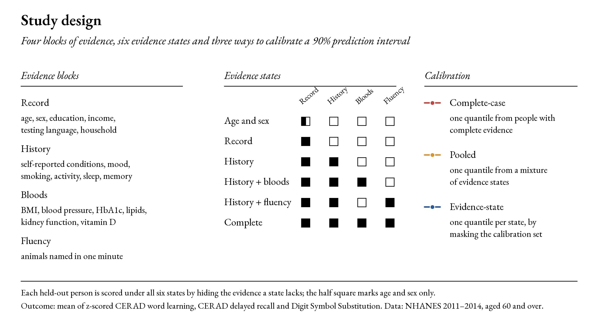
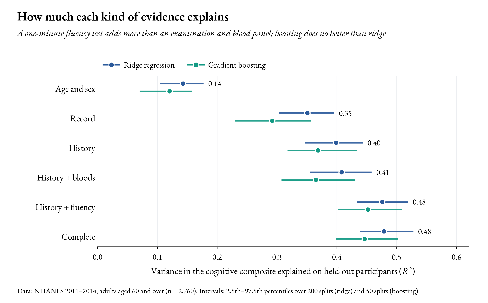
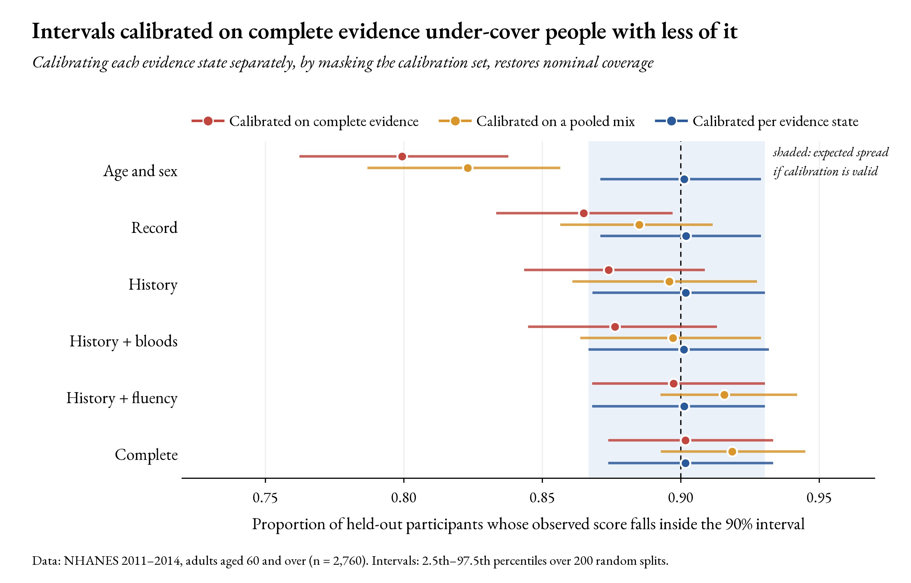
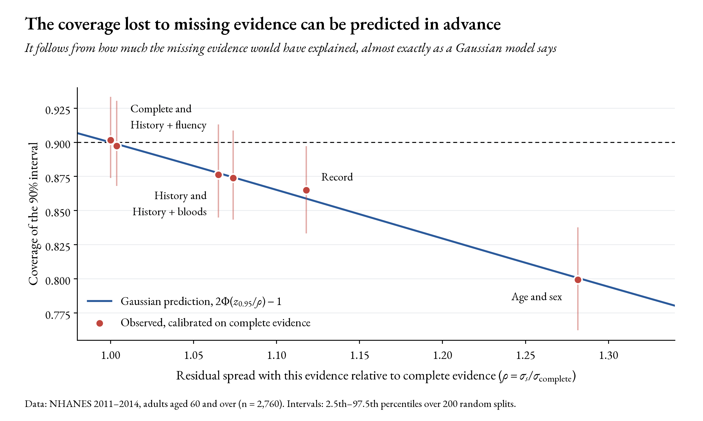
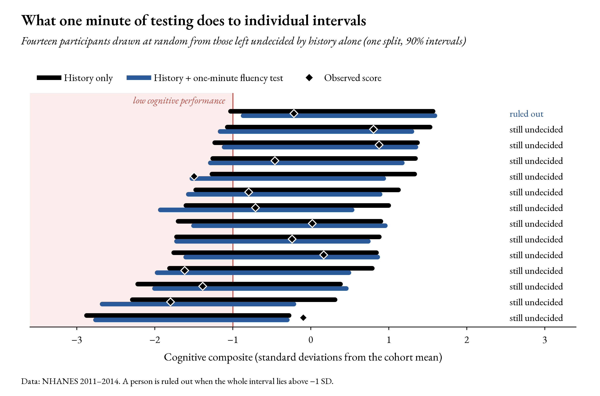
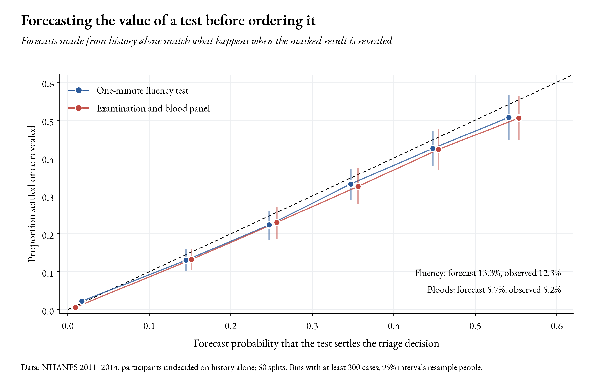
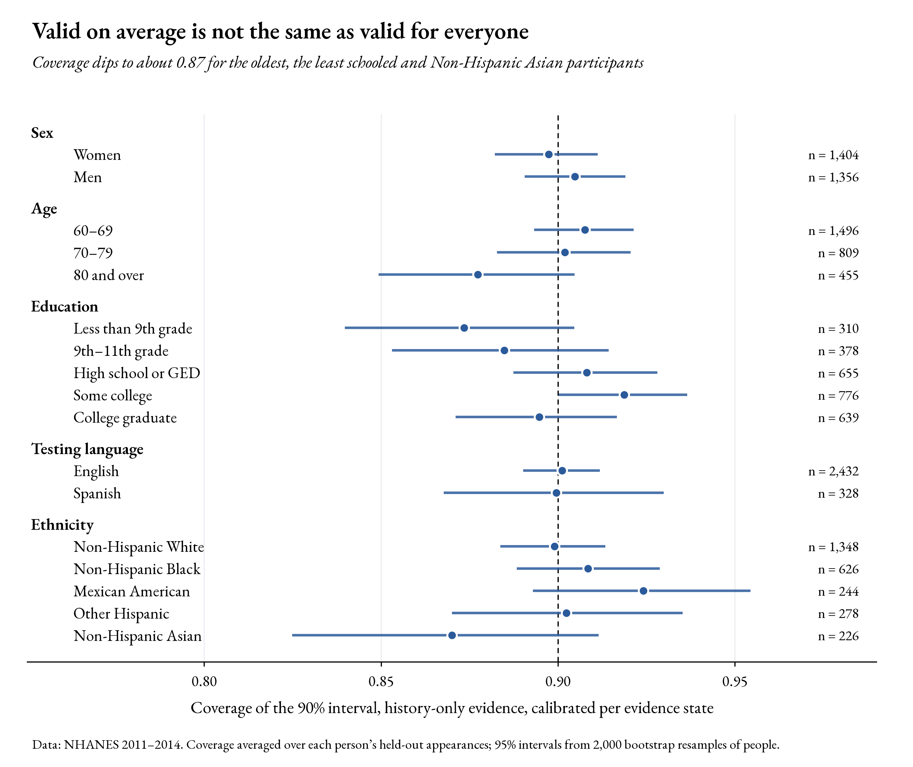

# Which Test Next? Evidence-Aware Prediction Intervals for Cognitive Performance in Older Adults

<p align="center">
  
  
  
  
  
  
  
</p>

**Research context:** Explainable and trustworthy AI for early dementia detection </br>
**Study type:** Independent pre-doctoral feasibility study </br>
**Data:** NHANES 2011–2014 cognitive functioning sample, adults aged 60 and over (public use) </br>

---

<p align="center">
  
</p>

## Abstract

Risk tools for cognitive decline are usually calibrated in cohorts where most people have had most tests, and then used on people who have had far fewer. I wanted to know what this does to the uncertainty a tool reports, and whether it can be fixed cheaply. Using 2,760 adults aged 60 and over from the 2011–2014 National Health and Nutrition Examination Survey (NHANES), I predicted a composite of three cognitive tests from six nested states of evidence, ranging from age and sex alone to a full history, examination, blood panel and a one-minute verbal fluency test, and placed a 90% split-conformal interval around each prediction. Intervals calibrated on people with complete evidence covered 87.4% of people assessed from history alone and 79.9% of people assessed from age and sex alone. The loss agreed with a one-line Gaussian formula to within 0.6 percentage points in every state, so it can be anticipated before a tool is deployed. Calibrating each evidence state separately, by hiding evidence in the calibration set, restored coverage to 90.1–90.2% in every state and gave 89.2% for 174 people whose blood tests were genuinely missing. Among people left undecided by their history alone, a one-minute fluency test settled 12.3% of triage decisions and a blood panel 5.2%; forecasts made before the result was revealed were 13.3% and 5.7%. Coverage was close to 90% for most groups but fell to about 87% for people aged 80 and over, people with less than ninth-grade schooling and Non-Hispanic Asian participants. This is a small rehearsal, on public data, of one idea in a proposed doctoral project. It is not a clinical tool.

**Keywords:** conformal prediction; missing data; prediction intervals; value of information; cognitive ageing; dementia risk; NHANES; trustworthy AI.

---

## 1. Why this question

Dementia research is moving from *whether* to test someone to *which test comes next*. Blood tests for phosphorylated tau can now be taken at home (Corbett et al., 2026), and the population benefit of testing in sequence has been shown (Ossenkoppele et al., 2025). Remote cohorts hold years of online cognitive testing for people who have never had a scan or a blood draw. Most of these people will reach a risk tool with some evidence missing.

A 90% prediction interval makes a promise: for people like this one, the outcome will fall inside nine times out of ten. The promise rests on the calibration data. If a tool is calibrated in a research cohort where everyone has had bloods and cognitive tests, and is then used on someone who has had neither, the interval is built from the errors of better-informed predictions. It will be too narrow, and nothing in the output says so.

This study measures that problem on public data, tests the simplest fix I could find, and then asks the question that follows from it: if a test is missing, how much would measuring it change the decision? It grew out of my work on intervals with exact finite-sample coverage (Hosseini, 2026). It deliberately uses no imaging, knowledge graph or language model. Those belong to doctoral research, not to a feasibility study.

---

## 2. Research questions

| | Question | Result that would count against the idea |
|---|---|---|
| RQ1 | Do 90% intervals calibrated on complete evidence keep their coverage for people assessed with less? | Coverage inside the finite-sample band in every evidence state |
| RQ2 | Can the size of any loss be predicted from how much the missing evidence explains? | Observed coverage far from the Gaussian prediction |
| RQ3 | Does calibrating each evidence state separately restore coverage, including when evidence is genuinely missing? | Coverage outside the band in any state, or for the real-missingness cohort |
| RQ4 | Can the chance that a test settles a triage decision be forecast before the test is ordered? | Forecasts that disagree with the revealed results |

A secondary audit asks whether coverage holds across sex, age, education, testing language and ethnicity.

---

## 3. Data

NHANES gave three cognitive tests to participants aged 60 and over in the 2011–2012 and 2013–2014 cycles: the CERAD word-learning test with delayed recall, an animal fluency test and the Digit Symbol Substitution Test (Brody et al., 2019; Morris et al., 1989). The public files are downloaded from the CDC when the notebook runs; no data are stored in this repository.

**Table 1. Cohorts and outcome**

| Property | Value |
|---|---|
| Source | National Health and Nutrition Examination Survey, 2011–2012 and 2013–2014 |
| Main cohort | 2,760 adults with all outcome tests, the fluency test and all seven blood markers |
| Real-missingness cohort | 174 adults with the outcome and fluency tests but at least one blood marker missing |
| Outcome | Mean of z-scored CERAD immediate recall, CERAD delayed recall and Digit Symbol Substitution, re-standardised to mean 0, SD 1 |
| Low cognitive performance | Composite below −1 SD (16.1% of the main cohort) |
| Used only for auditing | Race and ethnicity |
| Used only for a sensitivity check | Examination survey weights |

The people with missing bloods were the same age on average as the main cohort (69.6 and 69.5 years) but scored lower on the composite (mean −0.25 against 0.03 SD), and a quarter of them (25.3%) fell below −1 SD, against 16.1% of the main cohort. That makes them a useful test: they are the kind of people whose evidence is missing for a reason.

Animal fluency is kept out of the outcome on purpose. It plays the part of a brief test that could be given by telephone before a full assessment.

---

## 4. Methods

### 4.1 Evidence states

Four blocks of evidence are nested into six states (Figure 1). Each state has its own ridge regression, fitted on the training split with median imputation and missingness indicators for the occasional value missing inside a block.

| Evidence state | Contents | Predictors |
|---|---|---:|
| Age and sex | age, sex | 2 |
| Record | age, sex, education, income-to-poverty ratio, birthplace, testing language, partnership, living alone, insurance | 9 |
| History | Record plus self-reported hypertension, diabetes, heart disease and stroke, PHQ-9 depression score (Kroenke et al., 2001), smoking, physical activity, sedentary time, sleep, self-rated health and two memory-complaint items | 23 |
| History + bloods | History plus BMI, waist, measured blood pressure, HbA1c, total and HDL cholesterol, albumin, haemoglobin, vitamin D and eGFR (Inker et al., 2021) | 34 |
| History + fluency | History plus animals named in one minute | 24 |
| Complete | everything above | 35 |

Race and ethnicity are never used as predictors. Including them would let the model absorb differences in test scores that reflect schooling, language and structural disadvantage, which is exactly what the coverage audit is meant to expose.

### 4.2 Prediction intervals

For a model $\hat\mu_s$ and a calibration set of $n$ people with absolute residuals $R_i = |Y_i - \hat\mu_s(X_i)|$, the split-conformal interval is

$$
\hat\mu_s(x) \pm \hat q, \qquad \hat q = R_{(\lceil (n+1)(1-\alpha) \rceil)},
$$

which covers a new exchangeable observation with probability at least $1-\alpha$ (Vovk et al., 2005; Lei et al., 2018; see Angelopoulos & Bates, 2023, for an introduction). Here $\alpha = 0.10$.

### 4.3 Three calibration schemes

The three schemes differ only in which residuals are used to compute $\hat q$.

| Scheme | Residuals used for $\hat q$ | What it represents |
|---|---|---|
| Complete-case | those of the complete-evidence model, applied to every state | a tool calibrated in a well-measured research cohort |
| Pooled | one residual per calibration person, from a deployment mix (History 55%, History + bloods 20%, History + fluency 15%, Complete 10%) | a tool calibrated on a realistic mixture, as a whole |
| Evidence-state | those of the state-$s$ model on the full calibration set | a separate calibration for each pattern of evidence |

The evidence-state scheme is possible because evidence can be hidden from anyone who has it, so every calibration person contributes a residual to every state. It is a Mondrian conformal predictor whose categories are evidence patterns (Vovk et al., 2005; Vovk, 2012), and it is essentially the missing-data augmentation that Zaffran et al. (2023) proposed for conformal prediction with missing values. I did not invent it; the contribution here is to measure how much it matters in a cognitive-screening setting and to connect it to a triage decision.

### 4.4 A formula for the loss

If prediction errors under state $s$ were Gaussian with spread $\sigma_s$, an interval calibrated on complete evidence would have half-width $z_{1-\alpha/2}\,\sigma_{\mathrm{complete}}$ and would cover with probability

$$
\mathrm{coverage}_s \approx 2\Phi\!\left(\frac{z_{1-\alpha/2}}{\rho_s}\right) - 1, \qquad \rho_s = \frac{\sigma_s}{\sigma_{\mathrm{complete}}}.
$$

The ratio $\rho_s$ is a direct measure of how much the missing evidence would have explained. The formula is elementary; the question is whether real cognitive data behave closely enough to it for it to be useful.

### 4.5 Triage and the value of the next test

A person is *ruled out* when their whole 90% interval lies above −1 SD, *flagged* when it lies below, and *undecided* otherwise. For each person undecided on history alone, I forecast the probability that a test would settle the decision. The missing result is simulated 200 times from a ridge regression of that result on the person's history, with training residuals resampled jointly so that the blood markers keep their correlations. Each simulated result is passed through the corresponding evidence-state model and interval. The forecast is then compared with what actually happens when the real result, hidden until that point, is revealed. As a sensitivity analysis, the simulation is repeated by borrowing results from each person's 50 nearest neighbours in the history space.

### 4.6 Validation

Each of 200 random splits uses half of the main cohort for training, a quarter for calibration and a quarter for testing; every test participant is scored under every evidence state. Gradient boosting is fitted on the first 50 splits as a non-linear comparison, the value-of-information experiment uses the first 60, and conformalised quantile regression (Romano et al., 2019) is run on the first 100 as a robustness check. The real-missingness cohort is never used for fitting or calibration. All randomness is seeded.

---

## 5. Results

### 5.1 How much each kind of evidence explains

<p align="center">
  
</p>

**Table 2. Held-out explained variance ($R^2$), mean over splits with 2.5th–97.5th percentiles**

| Evidence state | Ridge regression | Gradient boosting |
|---|---:|---:|
| Age and sex | 0.143 [0.104, 0.177] | 0.120 [0.070, 0.158] |
| Record | 0.351 [0.303, 0.395] | 0.292 [0.230, 0.357] |
| History | 0.399 [0.346, 0.443] | 0.369 [0.317, 0.434] |
| History + bloods | 0.408 [0.355, 0.458] | 0.365 [0.307, 0.431] |
| History + fluency | 0.476 [0.433, 0.519] | 0.452 [0.401, 0.509] |
| Complete | 0.479 [0.438, 0.528] | 0.447 [0.398, 0.502] |

The record does most of the work: education, income, testing language and the other register items lift $R^2$ from 0.14 to 0.35. History adds about five points. The examination and blood panel add one more, and the one-minute fluency test adds eight. Gradient boosting was worse than ridge regression at every state, which is a reminder that with about 1,400 training cases and mostly additive signals, a flexible model is not automatically a better one.

### 5.2 Intervals calibrated on complete evidence under-cover people with less

<p align="center">
  
</p>

**Table 3. Mean coverage of 90% intervals over 200 splits**

| Evidence state | Complete-case | Pooled | Evidence-state | Evidence-state width (SD units) |
|---|---:|---:|---:|---:|
| Age and sex | 0.799 | 0.823 | 0.901 | 3.03 |
| Record | 0.865 | 0.885 | 0.902 | 2.62 |
| History | 0.874 | 0.896 | 0.902 | 2.53 |
| History + bloods | 0.876 | 0.897 | 0.901 | 2.52 |
| History + fluency | 0.897 | 0.916 | 0.901 | 2.39 |
| Complete | 0.902 | 0.919 | 0.902 | 2.36 |

Calibrated on complete evidence, the interval is a fixed width of 2.36 SD for everyone, so it is honest only for people who have complete evidence. Pooled calibration is valid for the mixture as a whole but still wrong for each state: too narrow when evidence is thin and too wide when it is rich. Calibrating each state separately put coverage within half a point of 90% in all six states. The price is width, and the widths themselves carry information: the interval grows from 2.36 SD with complete evidence to 2.53 SD with history alone and 3.03 SD with age and sex. An interval that widens when evidence is missing is telling the user something true.

### 5.3 The size of the loss can be predicted

<p align="center">
  
</p>

| Evidence state | $\rho_s$ | Predicted coverage | Observed coverage |
|---|---:|---:|---:|
| Age and sex | 1.282 | 0.801 | 0.799 |
| Record | 1.118 | 0.859 | 0.865 |
| History | 1.074 | 0.874 | 0.874 |
| History + bloods | 1.065 | 0.878 | 0.876 |
| History + fluency | 1.004 | 0.899 | 0.897 |
| Complete | 1.000 | 0.900 | 0.902 |

The largest gap between prediction and observation was 0.006. In practice, this means a team can estimate how badly a borrowed calibration will under-cover a new population before deploying it, using nothing more than the ratio of residual spreads under the two evidence patterns.

### 5.4 People whose bloods are genuinely missing

Masking hides evidence at random. People who skip a blood draw do not do so at random, so the evidence-state intervals were also checked on the 174 people whose bloods were really missing.

| Evidence state | Participants | Coverage | 95% interval (people resampled) |
|---|---:|---:|---|
| History | 174 | 0.892 | [0.848, 0.934] |
| History + fluency | 174 | 0.906 | [0.862, 0.945] |

Coverage held. With 174 people the interval is wide, and a shortfall of two or three points could not be ruled out, but there is no sign of the large failure that informative missingness could have caused.

### 5.5 What the next test would change

On history alone, 38% of people were ruled out with 90% intervals, 62% were undecided and almost none were flagged. These predictors can often say that low performance is unlikely; they can almost never say that it is likely.

<p align="center">
  
</p>

<p align="center">
  
</p>

**Table 4. Undecided cases settled by each test, pooled over 60 splits**

| Test | Forecast (regression) | Forecast (neighbours) | Observed | Brier score (regression) | Brier score (neighbours) |
|---|---:|---:|---:|---:|---:|
| One-minute fluency test | 13.3% | 15.5% | 12.3% | 0.0835 | 0.0882 |
| Examination and blood panel | 5.7% | 6.6% | 5.2% | 0.0341 | 0.0357 |

A one-minute fluency test settles more than twice as many undecided cases as an examination with a blood panel, which needs a visit. The forecasts from the regression simulation were close to what happened when the hidden result was revealed, bin by bin (Figure 6). Borrowing results from neighbours over-stated the value of both tests. With more than twenty history variables, even the nearest neighbours are not very near, so the borrowed results vary more than the true conditional distribution does. Among people newly ruled out after a test, 3.3% (fluency) and 3.9% (bloods) in fact scored below −1 SD, against 2.6% among those ruled out on history alone.

The blood panel here is a routine one: glucose control, lipids, kidney function and so on. It contains no Alzheimer's biomarkers, so this result says nothing about the value of a phosphorylated tau test.

### 5.6 Coverage across groups

<p align="center">
  
</p>

Coverage was close to 90% for women and men, both testing languages and most ethnic groups. It was lower, at about 87–88%, for people aged 80 and over, people with less than ninth-grade schooling and Non-Hispanic Asian participants, and higher, at 92%, for people with some college education. Each of the lower intervals still reaches 0.90 and seventeen groups were compared, so this is a signal to follow up rather than a finding. It is consistent with a known limit: no interval method can guarantee coverage within every subgroup without being told the subgroups (Barber et al., 2021). Group-conditional calibration (Romano et al., 2020) would fix the average for a named group at the cost of wider intervals, and deciding which groups to name is a clinical and ethical question, not a statistical one.

### 5.7 Robustness checks

**Table 5. Conformalised quantile regression, mean coverage over 100 splits**

| Evidence state | Complete-case | Evidence-state |
|---|---:|---:|
| Age and sex | 0.920 | 0.901 |
| Record | 0.916 | 0.902 |
| History | 0.907 | 0.902 |
| History + bloods | 0.901 | 0.902 |
| History + fluency | 0.908 | 0.901 |
| Complete | 0.902 | 0.902 |

This check changed my reading of Section 5.2. With conformalised quantile regression, the quantile models themselves are trained under each evidence state and learn its spread, so complete-case calibration did not under-cover; it over-covered slightly. The loss in Section 5.2 is therefore a property of calibrations that put all of the width into the conformal step, such as the absolute-residual method that is most common in practice, and not of conformal prediction in general. Evidence-state calibration was valid under both methods.

Reweighting coverage with the NHANES examination weights, so that it refers to the US population aged 60 and over rather than to the sample, moved evidence-state coverage from 0.901 to 0.904 with history alone and from 0.901 to 0.908 with complete evidence.

---

## 6. What is established, what is new, and what is left

| | |
|---|---|
| **Established methods** | Split-conformal prediction and its finite-sample guarantee (Vovk et al., 2005; Lei et al., 2018); Mondrian calibration (Vovk, 2012); missing-data augmentation for conformal prediction (Zaffran et al., 2023); pattern submodels for missing predictors (Mercaldo & Blume, 2020); conformalised quantile regression (Romano et al., 2019); equalised coverage (Romano et al., 2020). |
| **What this study adds** | A measurement, on real cognitive data, of how much complete-case calibration under-covers people assessed with less evidence; evidence that the loss follows the Gaussian formula closely enough to be anticipated; a check on people whose evidence is genuinely missing; and a forecast of the value of the next test that is validated by revealing masked results. |
| **Left for doctoral research** | Censored and longitudinal outcomes, where the decision is about future decline rather than a current score; Alzheimer's biomarkers such as plasma phosphorylated tau; imaging, which none of these participants had; evidence represented as knowledge-graph concepts rather than as blocks of variables; and finding out whether clinicians make better decisions with intervals that widen when evidence is missing. |

---

## 7. Limitations

- **A current score, not future decline.** The outcome is cognitive performance measured on the same day as the predictors. Early detection is about change over time, and the 2011–2014 NHANES cycles have no follow-up cognitive testing.
- **Not dementia.** A low score on three tests is not a diagnosis. NHANES has no clinical assessment of dementia.
- **Masking is random; life is not.** The evidence-state guarantee holds when the evidence a person lacks does not depend on their outcome. The 174 people with genuinely missing bloods passed the check, but they are few, and a subtler dependence could remain.
- **Routine bloods only.** None of the blood markers is specific to Alzheimer's disease.
- **One sample.** All splits draw on the same 2,760 people. A second cohort, collected with different instruments, would be the real test of the formula in Section 5.3.
- **Survey design.** The main analysis treats NHANES as a sample of people, not as a design-based estimate for the US population. Reweighting changed coverage very little, but the strata and primary sampling units are not used.

---

## 8. Reproducing the analysis

The notebook is the full analysis. Running it from top to bottom downloads the NHANES files (about 90 MB) to `~/.cache/evidence_aware_uncertainty`, runs every experiment and writes every figure in `figures/`. It took about twelve minutes on a laptop.

```python
ALPHA = 0.10            # 90% prediction intervals
THRESHOLD = -1.0        # low cognitive performance: composite below -1 SD
N_REPEATS = 200         # random train / calibration / test splits
RANDOM_STATE = 2026
```

| Reproducibility control | Status |
|---|---|
| Data | Downloaded from the CDC on first run; nothing stored in the repository |
| Randomness | One seeded generator for splits, mixtures and simulations |
| Leakage | Models, imputers and scalers fitted on training splits only; calibration on a separate quarter |
| Held-out check | The real-missingness cohort is never used for fitting or calibration |
| Figures | Generated by the notebook in EB Garamond (SIL Open Font Licence), downloaded on first run |
| Software | Python 3.13 with NumPy, pandas, SciPy, scikit-learn (Pedregosa et al., 2011) and matplotlib; exact versions are printed by the notebook |

```bash
pip install numpy pandas scipy scikit-learn matplotlib jupyter
jupyter nbconvert --to notebook --execute --inplace notebook.ipynb
```

---

## References

Angelopoulos, A. N., & Bates, S. (2023). Conformal prediction: A gentle introduction. *Foundations and Trends in Machine Learning, 16*(4), 494–591. https://doi.org/10.1561/2200000101

Barber, R. F., Candès, E. J., Ramdas, A., & Tibshirani, R. J. (2021). The limits of distribution-free conditional predictive inference. *Information and Inference: A Journal of the IMA, 10*(2), 455–482. https://doi.org/10.1093/imaiai/iaaa017

Brody, D. J., Kramarow, E. A., Taylor, C. A., & McGuire, L. C. (2019). *Cognitive performance in adults aged 60 and over: National Health and Nutrition Examination Survey, 2011–2014* (National Health Statistics Reports No. 126). National Center for Health Statistics.

Corbett, A., Sander-Long, M., Ashton, N. J., Huber, H., Vavra, J., Braun-Wohlfahrt, L. S., Zetterberg, H., Montoliu-Gaya, L., Cummings, J., Bateman, F., et al. (2026). Alzheimer's disease blood biomarkers measured through remote capillary sampling correlate with cognition in older adults. *Nature Communications, 17*(1), 3699. https://doi.org/10.1038/s41467-026-71448-2

Hosseini, S. A. (2026). Exact prevalence regions: Finite-sample uncertainty quantification, threshold decisions, and monitoring for class-prevalence analytics under prior probability shift. *International Journal of Data Science and Analytics*. Accepted for publication.

Inker, L. A., Eneanya, N. D., Coresh, J., Tighiouart, H., Wang, D., Sang, Y., Crews, D. C., Doria, A., Estrella, M. M., Froissart, M., et al. (2021). New creatinine- and cystatin C–based equations to estimate GFR without race. *New England Journal of Medicine, 385*(19), 1737–1749. https://doi.org/10.1056/NEJMoa2102953

Kroenke, K., Spitzer, R. L., & Williams, J. B. W. (2001). The PHQ-9: Validity of a brief depression severity measure. *Journal of General Internal Medicine, 16*(9), 606–613. https://doi.org/10.1046/j.1525-1497.2001.016009606.x

Lei, J., G'Sell, M., Rinaldo, A., Tibshirani, R. J., & Wasserman, L. (2018). Distribution-free predictive inference for regression. *Journal of the American Statistical Association, 113*(523), 1094–1111. https://doi.org/10.1080/01621459.2017.1307116

Mercaldo, S. F., & Blume, J. D. (2020). Missing data and prediction: The pattern submodel. *Biostatistics, 21*(2), 236–252. https://doi.org/10.1093/biostatistics/kxy040

Morris, J. C., Heyman, A., Mohs, R. C., Hughes, J. P., van Belle, G., Fillenbaum, G., Mellits, E. D., & Clark, C. (1989). The Consortium to Establish a Registry for Alzheimer's Disease (CERAD). Part I. Clinical and neuropsychological assessment of Alzheimer's disease. *Neurology, 39*(9), 1159–1165. https://doi.org/10.1212/WNL.39.9.1159

Ossenkoppele, R., Salvadó, G., Janelidze, S., Pichet Binette, A., Bali, D., Karlsson, L., Palmqvist, S., Mattsson-Carlgren, N., Stomrud, E., Therriault, J., et al. (2025). Plasma p-tau217 and tau-PET predict future cognitive decline among cognitively unimpaired individuals: Implications for clinical trials. *Nature Aging, 5*(5), 883–896. https://doi.org/10.1038/s43587-025-00835-z

Pedregosa, F., Varoquaux, G., Gramfort, A., Michel, V., Thirion, B., Grisel, O., Blondel, M., Prettenhofer, P., Weiss, R., Dubourg, V., Vanderplas, J., Passos, A., Cournapeau, D., Brucher, M., Perrot, M., & Duchesnay, É. (2011). Scikit-learn: Machine learning in Python. *Journal of Machine Learning Research, 12*, 2825–2830.

Romano, Y., Barber, R. F., Sabatti, C., & Candès, E. J. (2020). With malice toward none: Assessing uncertainty via equalized coverage. *Harvard Data Science Review, 2*(2). https://doi.org/10.1162/99608f92.03f00592

Romano, Y., Patterson, E., & Candès, E. J. (2019). Conformalized quantile regression. In *Advances in Neural Information Processing Systems 32*.

Vovk, V. (2012). Conditional validity of inductive conformal predictors. In *Proceedings of the Asian Conference on Machine Learning*, PMLR 25, 475–490.

Vovk, V., Gammerman, A., & Shafer, G. (2005). *Algorithmic learning in a random world*. Springer. https://doi.org/10.1007/b106715

Zaffran, M., Dieuleveut, A., Josse, J., & Romano, Y. (2023). Conformal prediction with missing values. In *Proceedings of the 40th International Conference on Machine Learning*, PMLR 202, 40578–40604.

---

## Licence

This repository uses a dual-licence structure:

- Code, notebooks, scripts, configuration files, executable components, and original software materials are licensed under the MIT Licence. See `LICENSE.md`.
- README text, documentation, research explanations, methodological descriptions, diagrams, tables, figures, and other written or visual materials are licensed under the Creative Commons Attribution-NonCommercial 4.0 International Licence (CC BY-NC 4.0). See `LICENSE.md`.

External datasets, APIs, third-party libraries, package dependencies, academic papers, badges, images, trademarks, and source materials remain subject to their own licences and terms of use. NHANES data are public-use files from the National Center for Health Statistics. This repository does not relicense third-party materials.
